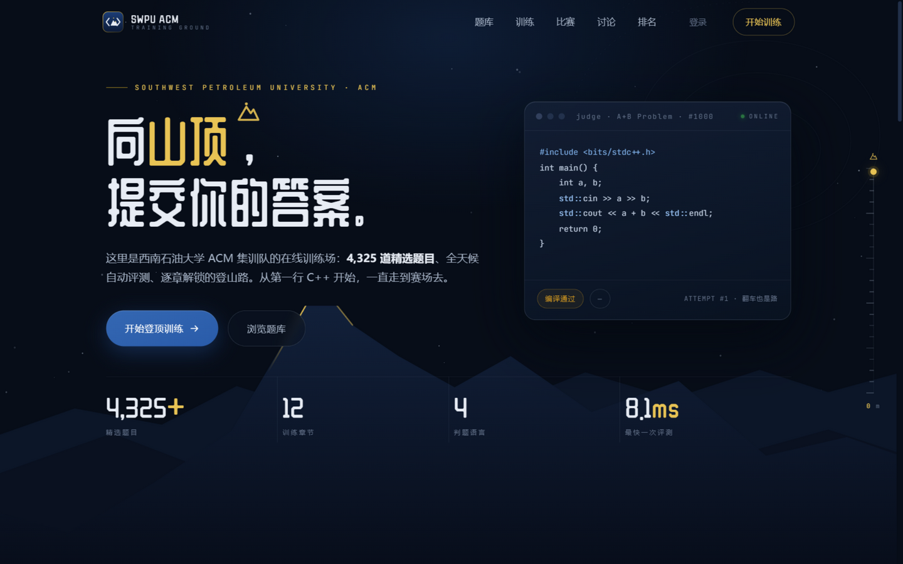
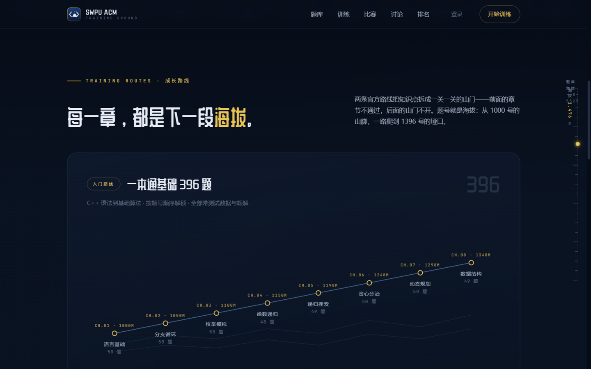
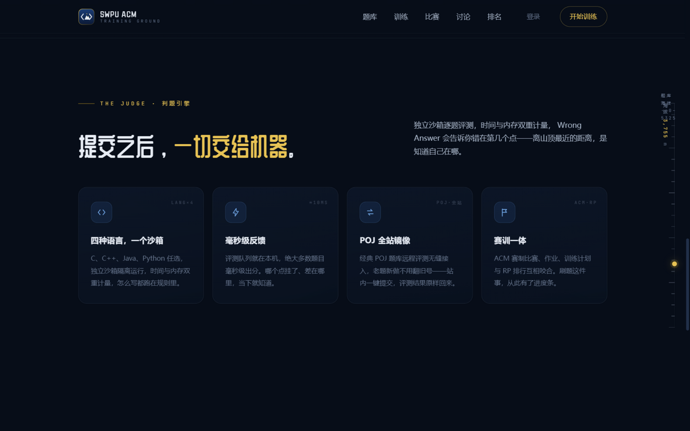
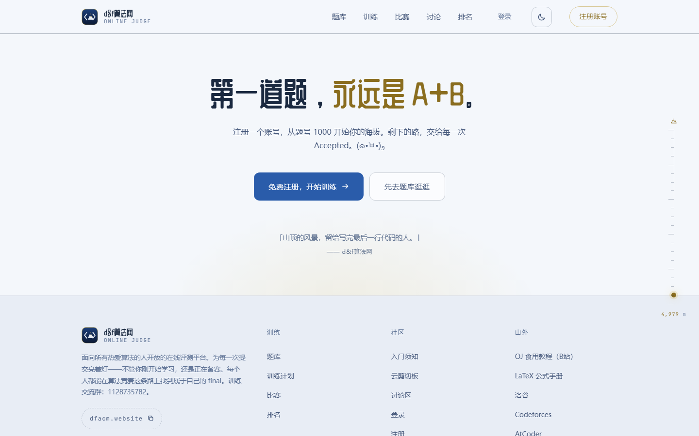
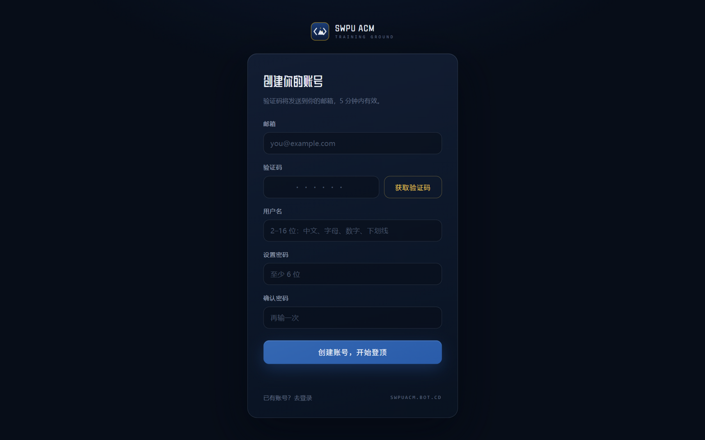
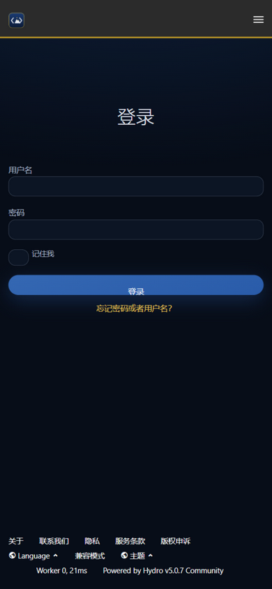

# d&f算法网

[](https://github.com/11suixing11/dfacm-oj/actions/workflows/ci.yml)
[](LICENSE)

> 每个人都能在算法竞赛这条路上找到属于自己的 final。

面向算法学习与竞赛训练的在线评测平台，将做题、复盘、赛事信息与社区互动放在同一个站点。平台基于 [Hydro OJ](https://hydro.ac)，本仓库维护品牌首页、认证页面、训练插件、AI 题目助手、主题与部署工具。

**[访问平台](https://dfacm.website) · [开始做题](https://dfacm.website/p) · [赛事日历](https://dfacm.website/calendar) · [部署文档](deploy/deployment.md)**

主域名为 [dfacm.website](https://dfacm.website)，[swpuacm.xyz](https://swpuacm.xyz) 保留为兼容入口。



## 平台功能

| 功能 | 使用场景 | 文档 |
| --- | --- | --- |
| 统一认证 | 在 `/reg` 注册、验证码登录或密码登录；按配置启用 GitHub、linux.do 第三方登录 | [认证插件](plugin-dfacm-regcode/README.md) · [linux.do 登录](plugin-linuxdo-oauth/README.md) |
| 训练工作台 | 在 `/workbench` 继续当前训练，查看下一题、本周进度和最近未通过的题目 | [训练插件](plugin-dfacm-train/README.md) |
| 错题复习 | 在 `/mistakes` 查看自动收集的错题，记录原因和复盘笔记，跟踪补题状态 | [错题本](plugin-dfacm-train/README.md) |
| AI 题目助手 | 在题目旁展开小窗，获取提示、算法思路、完整题解，或分析失败提交与粘贴代码 | [助手插件](plugin-dfacm-assistant/README.md) |
| 积分与徽章 | 首次 AC 获得积分，在 `/shop` 兑换徽章，在 `/shop/title` 创建个人称号 | [积分商店](plugin-dfacm-shop/README.md) |
| 赛事日历 | 在 `/calendar` 筛选赛事、查看报名截止、订阅 ICS 日历；支持 CF、AtCoder 与 CLIST 数据源 | [赛事日历](plugin-dfacm-calendar/README.md) |
| QQ 社区播报 | 自动播报 AC、榜单和比赛动态，提供账号绑定、签到与赛程提醒 | [QQ 播报](plugin-dfacm-broadcast/README.md) |
| 管理与排名 | RP 自动更新、成员对账、训练周报与评测健康摘要 | [运维插件](plugin-dfacm-ops/README.md) |

首页和 OJ 页面支持浅色、深色主题；首页、认证页和题目助手适配手机使用。

## AI 题目助手

在题目页或自己的提交详情页，点击右下角 **“题目助手”** 展开。桌面使用浮窗，手机使用底部抽屉，答案区域独立滚动。

| 帮助方式 | 返回内容 |
| --- | --- |
| 提示 | 关键观察和下一步方向 |
| 思路 | 算法选择、关键步骤与正确性理由 |
| 完整题解 | 题意提炼、算法思路、C++ 参考代码、复杂度与易错点评 |
| 代码诊断 | 结合 WA / CE / TLE / RE 分析问题；引用原代码行，CE 可结合实际编译日志 |

### 使用步骤

1. 登录后进入 **[账户设置 → AI 设置](https://dfacm.website/home/settings/account#ai)**，选择 AgentRouter 或自定义供应商，填写模型与自己的 API Key，保存配置。
2. 打开 [A+B 题目](https://dfacm.website/p/P1000)，展开助手。选择讲解层级，或选择“最近失败提交”“粘贴代码”进行诊断。
3. 点击对应的 **生成 / 诊断** 按钮，查看结果。切换类型、层级或收起窗口会保留当前状态；已有答案可直接继续阅读。

供应商配置跟随 OJ 账户，换题、刷新或换设备时共用。API Key 在服务端加密保存，保存后不回显；模型请求使用所选供应商的个人额度。保存设置和切换视图不调用模型，生成时展示实际阶段、耗时、供应商返回的 tokens 与缓存复用情况。

AgentRouter 默认地址为 `https://agentrouter.org/v1`，默认模型为 `gpt-5.6-sol`，账户需具备相应客户端接入和模型权限。[注册 AgentRouter（邀请链接）](https://agentrouter.org/register?aff=SeEq)。自定义供应商需提供兼容 Chat Completions、JSON 输出和工具调用的公开 HTTPS 接口。

助手已部署到当前站点，本地测试和部署检查已完成。真实个人 Key 的模型生成与浏览器视觉验收仍待验证；代码诊断提供静态分析和推演结论。安装、权限、接口兼容与验证范围见 [助手说明](plugin-dfacm-assistant/README.md)，部署证据见 [上线记录](docs/assistant-release-2026-10-22.md)。

## 界面预览

<details>
<summary>展开训练路线、评测演示与移动端认证页截图</summary>

<p>
  
  
</p>
<p>
  
  
  
</p>

</details>

## 本地预览

建议使用 **Node.js 22 或更新版本**。先检出仓库，启动首页与认证页预览：

```bash
git clone https://github.com/11suixing11/dfacm-oj.git
cd dfacm-oj
node scripts/preview.cjs
```

打开 <http://127.0.0.1:4173/> 查看首页，打开 <http://127.0.0.1:4173/reg> 查看认证页。这是静态预览，完整账号和评测功能由 Hydro 实例提供。

在仓库根目录另开终端，启动助手预览：

```bash
cd plugin-dfacm-assistant
npm ci --no-audit --no-fund
npm run preview
```

打开 <http://127.0.0.1:4175/home/settings/account#ai>，使用演示 Key 保存配置，再打开 <http://127.0.0.1:4175/p/P1001> 体验浮窗。助手预览使用固定题面、模拟回答和内存配置，重启后清空演示数据。

## 部署到 Hydro

当前集成按 **Hydro 5.0.7、ui-default 4.58.5** 验证，助手要求 Node.js 22 或更新版本。平台运行复用 Hydro 的账号、权限、MongoDB 和评测服务，定制功能通过 addon 接入。

首次安装按 [部署清单](deploy/deployment.md) 完成 Hydro、域名、Caddy、邮件和 addon 注册。后续更新可在本地仓库通过 Git Bash 或 Linux 运行部署脚本；请按自己的服务器填写连接参数：

```bash
export SSH_TARGET="root@your-server"
export SSH_KEY="/path/to/ssh-key"

bash deploy/deploy.sh --stage-only
```

| 命令 | 行为 |
| --- | --- |
| `bash deploy/deploy.sh --stage-only` | 上传暂存副本并核对哈希，供部署前检查 |
| `bash deploy/deploy.sh --sync-only` | 同步、安装并核对文件，适用于无需重启的静态改动 |
| `bash deploy/deploy.sh` | 暂存校验、安装校验、重启 Hydro，再执行就绪与站点检查 |

通用脚本当前覆盖首页、主题、认证、运维、训练、商店和日历。**[AI 助手](plugin-dfacm-assistant/README.md)、[QQ 播报](plugin-dfacm-broadcast/README.md) 和 [linux.do 登录](plugin-linuxdo-oauth/README.md) 按各自文档单独安装与更新。**

生产 addon 复用已安装的 Hydro 包；测试依赖应安装在仓库开发目录。AI 配置备份需同时保存账户数据库与原加密主密钥，步骤见 [助手维护说明](plugin-dfacm-assistant/README.md#账户加密存储与其他-ai-功能)。

## 开发与维护

| 目录 | 内容 |
| --- | --- |
| `landing/` | 首页、字体与品牌图标 |
| `plugin-dfacm-*/` | 认证、训练、商店、赛事、助手与运维插件 |
| `plugin-linuxdo-oauth/` | linux.do OAuth 接入 |
| `theme/` | Hydro 双主题品牌样式 |
| `deploy/` | 部署、安装、上游补丁与站点检查 |
| `scripts/` | 本地预览、备份、字体处理与回归检查 |
| `docs/` | 界面截图、发布记录与技术说明 |

功能以 Hydro addon 实现，首页静态资源由 Caddy 提供；上游调整集中在可重放的补丁脚本中。部分内部目录、集合名与环境变量保留 `swpu` 标识，以兼容现有部署和数据。

文档改动可运行仓库检查：

```bash
node --test scripts/repository.test.cjs
```

助手开发在 `plugin-dfacm-assistant/` 中运行：

```bash
npm test
npm run check-build
```

GitHub Actions 执行密钥扫描、仓库与部署检查、插件测试和助手构建检查。其他模块的测试方式见各自 README。

- [版本历史](CHANGELOG.md)
- [前端体验说明](docs/frontend-update.md)
- [主题方案](theme/README.md)
- [部署与恢复](deploy/deployment.md)

## 致谢与许可

感谢 [Hydro OJ](https://hydro.ac)、[badge-for-hydrooj](https://github.com/Godtokoo666/badge-for-hydrooj)、[AstrBot](https://github.com/AstrBotDevs/AstrBot) 等开源项目。

仓库代码采用 [MIT 许可](LICENSE)。字体与第三方资源遵循各自许可，字体说明见 [FONTS-LICENSE.md](landing/FONTS-LICENSE.md)。
