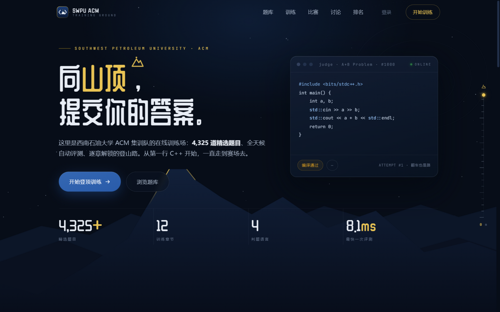
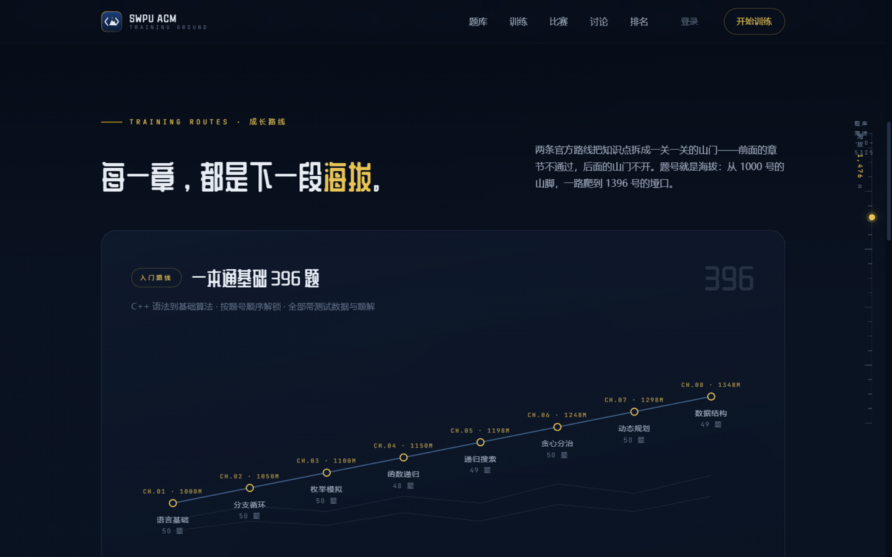
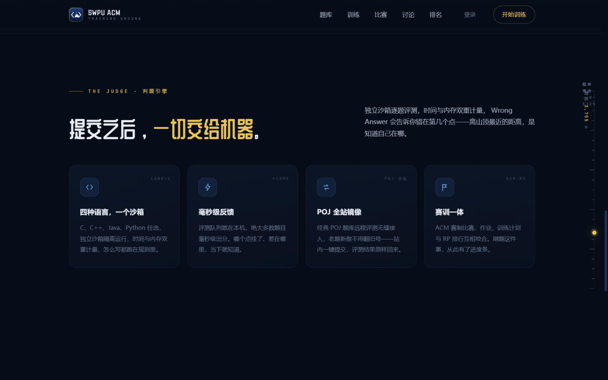
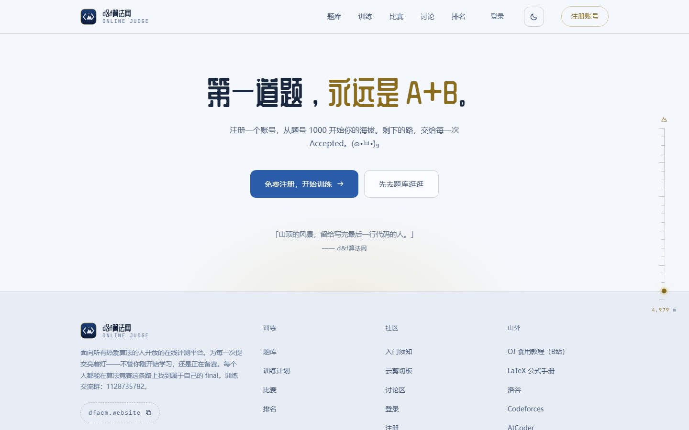
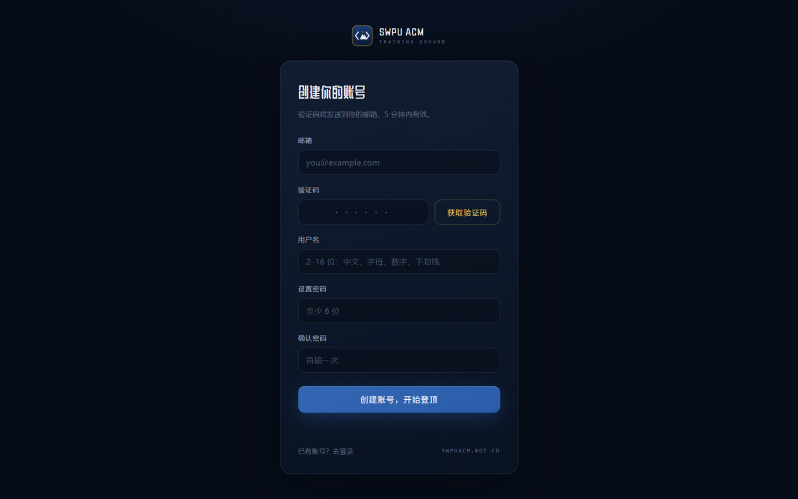
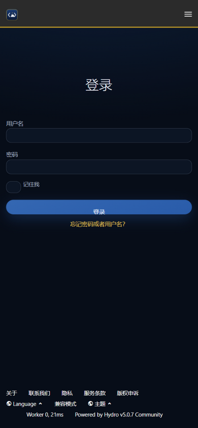

# d&f算法网

[](https://github.com/11suixing11/dfacm-oj/actions/workflows/ci.yml)
[](LICENSE)

**算法训练与 AI 开发的实践社区。练算法，做 AI 项目。**

围绕两条实践路径组织网站：算法侧按路线练习、提交评测与复盘；AI 侧围绕应用、Agent 和 Vibe Coding 完成小作品。两条路径共用赛事日历、账号和交流社区。算法竞赛的品牌寄语仍是：每个人都能在算法竞赛这条路上找到属于自己的 final。

**[访问平台](https://dfacm.website) · [算法训练](https://dfacm.website/training) · [AI 实践清单](docs/ai-practice.md) · [赛事日历](https://dfacm.website/calendar)**

主域名为 [dfacm.website](https://dfacm.website)，[swpuacm.xyz](https://swpuacm.xyz) 保留为兼容入口。

网站定位与入口规则见 [产品定位](docs/product.md)，代码职责和独立仓库关系见 [项目地图](docs/project-map.md)。维护时从 [文档索引](docs/README.md) 开始。

## 两条实践路径

| 方向 | 用户要完成的事 | 入口与现有能力 |
| --- | --- | --- |
| 算法训练 | 选路线 → 练题 → 提交 → 复盘 → 参赛 | `/training`、`/p`、`/workbench`、`/mistakes`、`/contest`；[训练插件](plugin-dfacm-train/README.md) |
| AI 开发 | 选任务 → 做作品 → 验证 → 分享 → 参加黑客松 | 首页 `#ai` 的三个实践任务；[AI 实践清单](docs/ai-practice.md)；作品在自己的开发环境中完成，站内提供赛事和交流入口 |
| 共同资源 | 找比赛、订阅赛程、交流经验 | `/calendar`、`/discuss`；[赛事日历](plugin-dfacm-calendar/README.md) |

AI 开发优先覆盖 AI 应用、Agent 与 Vibe Coding。模型训练和数据科学比赛继续由日历收录，作为扩展方向。项目托管、AI 开发沙箱、作品提交与专用进度系统仍待建设。

## 支持实践的工具

| 工具 | 职责 | 文档 |
| --- | --- | --- |
| 题目助手 | 算法提示、思路、完整题解和失败代码诊断，嵌入题目与提交页面 | [助手使用与配置](plugin-dfacm-assistant/README.md) |
| 账号与登录 | 邮箱验证码、密码和按配置启用的第三方登录 | [认证](plugin-dfacm-regcode/README.md) · [linux.do](plugin-linuxdo-oauth/README.md) |
| 积分与徽章 | 算法首次 AC 积分、徽章和称号 | [积分商店](plugin-dfacm-shop/README.md) |
| 社区播报 | QQ 的 AC、榜单、赛程和账号绑定 | [QQ 播报](plugin-dfacm-broadcast/README.md) |

题目助手由用户在 [账户设置 → AI 设置](https://dfacm.website/home/settings/account#ai) 配置个人供应商与 Key，再在题目页主动生成。它支持算法训练；AI 开发实践是独立的产品方向。

管理员工具另见 [运维插件](plugin-dfacm-ops/README.md) 与 [提交线索审核](plugin-dfacm-ai-watch/README.md)。审核分用于人工复核排序，不表示 AI 使用概率。它们属于后台维护，首页不作为实践方向推广。

首页和 OJ 页面支持浅色、深色主题；首页、认证页和题目助手适配手机使用。

## 当前进度

- 算法平台、统一日历及题目助手已有部署记录；验证范围见 [发布记录索引](docs/README.md#发布与验收记录)。
- 双主线首页和三个 AI 实践任务已于 2026-11-01 上线，部署范围与验证结果见 [本次整理记录](docs/project-organization-2026-11-01.md#服务器发布与验收)。
- 下一阶段优先建设 AI 项目目录、作品分享和轻量实践进度，详细顺序见 [产品建设安排](docs/product.md#建设顺序)。

## 界面记录

<details>
<summary>展开此前 OJ 界面截图（历史记录，不代表本次首页）</summary>



<p>
  
  
</p>
<p>
  
  
  
</p>

</details>

## 本地预览

建议使用 **Node.js 22 或更新版本**。先检出仓库，按锁文件安装训练预览依赖，再启动：

```bash
git clone https://github.com/11suixing11/dfacm-oj.git
cd dfacm-oj
cd plugin-dfacm-train
npm ci --no-audit --no-fund
cd ..
node scripts/preview.cjs
```

打开 <http://127.0.0.1:4173/> 查看首页，打开 <http://127.0.0.1:4173/reg> 查看认证页。训练目录在 <http://127.0.0.1:4173/training>，工作台在 <http://127.0.0.1:4173/workbench>；可体验进入题目、切换评测结果和返回章节。

预览使用固定题目和进度，完整账号和评测功能由 Hydro 实例提供。首页和认证页可不安装训练依赖直接预览；实时赛事需要对应后端，本地没有连接时保留页面入口。

在仓库根目录另开终端，启动助手预览：

```bash
cd plugin-dfacm-assistant
npm ci --no-audit --no-fund
npm run preview
```

打开 <http://127.0.0.1:4175/home/settings/account#ai>，使用演示 Key 保存配置，再打开 <http://127.0.0.1:4175/p/P1001> 体验浮窗。助手预览使用固定题面、模拟回答和内存配置，重启后清空演示数据。

## 部署到 Hydro

当前集成按 **Hydro 5.0.7、ui-default 4.58.5** 验证，助手要求 Node.js 22 或更新版本。平台运行复用 Hydro 的账号、权限、MongoDB 和评测服务，定制功能通过 addon 接入。

首次安装按 [部署清单](deploy/deployment.md) 完成 Hydro、域名、Caddy、邮件和 addon 注册。后续更新可在本地仓库通过 Git Bash 或 Linux 运行部署脚本；请按自己的服务器填写连接参数：

```bash
export SSH_TARGET="root@your-server"
export SSH_KEY="/path/to/ssh-key"

bash deploy/deploy.sh --stage-only
```

| 命令 | 行为 |
| --- | --- |
| `bash deploy/deploy.sh --stage-only` | 上传暂存副本并核对哈希，供部署前检查 |
| `bash deploy/deploy.sh --sync-only` | 同步、安装并核对文件，适用于无需重启的静态改动 |
| `bash deploy/deploy.sh` | 暂存校验、安装校验、重启 Hydro，再执行就绪与站点检查 |

通用脚本当前覆盖首页、主题、认证、运维、训练、商店和日历。**[AI 助手](plugin-dfacm-assistant/README.md)、[QQ 播报](plugin-dfacm-broadcast/README.md) 和 [linux.do 登录](plugin-linuxdo-oauth/README.md) 按各自文档单独安装与更新。**

生产 addon 复用已安装的 Hydro 包；测试依赖应安装在仓库开发目录。AI 配置备份需同时保存账户数据库与原加密主密钥，步骤见 [助手维护说明](plugin-dfacm-assistant/README.md#账户加密存储与其他-ai-功能)。

## 开发与维护

| 目录 | 内容 |
| --- | --- |
| `landing/` | 首页、字体与品牌图标 |
| `plugin-dfacm-*/` | 认证、训练、商店、赛事、助手与运维插件 |
| `plugin-linuxdo-oauth/` | linux.do OAuth 接入 |
| `theme/` | Hydro 双主题品牌样式 |
| `deploy/` | 部署、安装、上游补丁与站点检查 |
| `scripts/` | 本地预览、备份、字体处理与回归检查 |
| `docs/` | 界面截图、发布记录与技术说明 |

功能以 Hydro addon 实现，首页静态资源由 Caddy 提供；上游调整集中在可重放的补丁脚本中。部分内部目录、集合名与环境变量保留 `swpu` 标识，以兼容现有部署和数据。

文档改动可运行仓库检查：

```bash
node --test scripts/repository.test.cjs
```

助手开发在 `plugin-dfacm-assistant/` 中运行：

```bash
npm test
npm run check-build
```

GitHub Actions 执行密钥扫描、仓库与部署检查、插件测试和助手构建检查。其他模块的测试方式见各自 README。

- [版本历史](CHANGELOG.md)
- [前端体验说明](docs/frontend-update.md)
- [主题方案](theme/README.md)
- [部署与恢复](deploy/deployment.md)

## 致谢与许可

感谢 [Hydro OJ](https://hydro.ac)、[badge-for-hydrooj](https://github.com/Godtokoo666/badge-for-hydrooj)、[AstrBot](https://github.com/AstrBotDevs/AstrBot) 等开源项目。

仓库代码采用 [MIT 许可](LICENSE)。字体与第三方资源遵循各自许可，字体说明见 [FONTS-LICENSE.md](landing/FONTS-LICENSE.md)。
