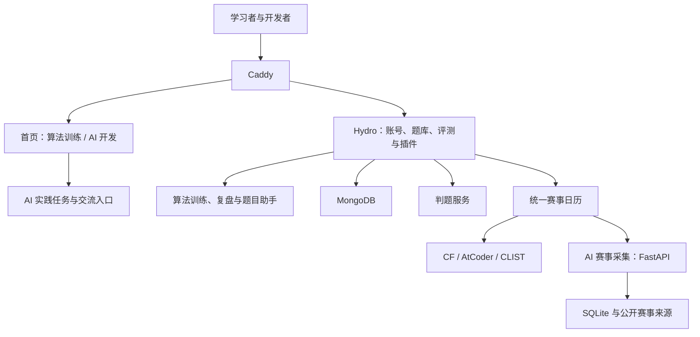

# d&f算法网 · 项目地图

`dfacmoj` 是工作目录，`dfacm-oj` 是网站集成仓库，`dfacm-calendar` 与 `hydro-ai-watch` 是两个独立开源仓库。网站以算法训练与 AI 开发两条主线组织，代码以功能模块与部署边界维护。

## 模块职责

| 职责 | 代码位置 | 入口或产物 | 维护文档 |
| --- | --- | --- | --- |
| 网站入口 | `landing/`、`theme/` | 双主线首页、品牌与主题 | [设计规则](../DESIGN.md) |
| 算法训练 | `plugin-dfacm-train/` | 工作台、错题本、训练目录增强 | [训练插件](../plugin-dfacm-train/README.md) |
| 算法 AI 工具 | `plugin-dfacm-assistant/` | 题目提示、解题与代码诊断 | [助手插件](../plugin-dfacm-assistant/README.md) |
| AI 开发内容 | 首页 `#ai`、`docs/ai-practice.md` | AI 应用、Agent、Vibe Coding 任务与验收清单 | [实践清单](ai-practice.md) |
| 共享赛事 | `plugin-dfacm-calendar/` | 统一清单、筛选、JSON、ICS 和 RSS | [日历插件](../plugin-dfacm-calendar/README.md) |
| 赛事采集 | `plugin-dfacm-ai-contests/` | Python 后台与本机只读 API | [采集组件](../plugin-dfacm-ai-contests/README.md) |
| 账号与认证 | `plugin-dfacm-regcode/`、`plugin-linuxdo-oauth/` | 邮件验证码、密码、第三方登录 | [认证](../plugin-dfacm-regcode/README.md) · [OAuth](../plugin-linuxdo-oauth/README.md) |
| 社区与激励 | `plugin-dfacm-shop/`、`plugin-dfacm-broadcast/` | 积分、称号、徽章、QQ 播报 | [商店](../plugin-dfacm-shop/README.md) · [播报](../plugin-dfacm-broadcast/README.md) |
| 管理维护 | `plugin-dfacm-ops/`、`plugin-dfacm-ai-watch/` | 排名更新、对账、提交证据与人工复核 | [运维](../plugin-dfacm-ops/README.md) · [审核](../plugin-dfacm-ai-watch/README.md) |
| 发布与检查 | `deploy/`、`scripts/` | 安装、补丁、备份、本地预览和检查 | [部署](../deploy/deployment.md) · [补丁](../deploy/PATCHES.md) |
| 题库治理 | `scripts/taxonomy/` | 题面、数据与题解审计及修复 | [题库治理](../scripts/taxonomy/README.md) |
| 验收与历史 | `docs/`、私有 `qa/` | 发布说明与本地证据 | [文档索引](README.md) |

当前 AI 开发内容由首页和文档承载。项目目录、在线作品提交和 AI 实践进度是明确的建设项，不将赛事采集器或题目助手改名冒充开发平台。

## 运行关系

生产集成基线是 Hydro 5.0.7 和 ui-default 4.58.5。Caddy 提供首页静态文件并转发 Hydro 路由，采集服务独立运行。AI 项目目前在学习者自己的开发环境中完成。

## 三个仓库如何协作

| 仓库 | 维护对象 | 同步方式 |
| --- | --- | --- |
| [dfacm-oj](https://github.com/11suixing11/dfacm-oj) | 站点集成、首页、主题、插件组合和生产部署说明 | 站点改动在本仓库检查与发布 |
| [dfacm-calendar](https://github.com/11suixing11/dfacm-calendar) | 通用日历与采集组件、公开安装包 | 通用修复对照站点目录同步，经两边测试后发布 |
| [hydro-ai-watch](https://github.com/11suixing11/hydro-ai-watch) | 通用审核插件与公开安装包 | 通用修复对照站点插件同步；生产验收留在私有 QA |

它们目前是普通目录中的独立仓库，副本不会自动同步。站点专用部署和私有证据留在主仓库对应文档或忽略目录；通用源码与安装说明进入公开组件仓库。同步前先看双方 Git 状态，对照有变化的文件，运行该模块已有检查，再记录版本与来源提交。

## 找到正确的工作入口

改定位或首页先读 [产品定位](product.md) 与 [设计规则](../DESIGN.md)。改插件先读该插件 README。上线前核对 [部署清单](../deploy/deployment.md) 与 [补丁清单](../deploy/PATCHES.md)。查旧问题先从 [发布记录](README.md#发布与验收记录) 进入。

顶层插件目录与已有 `swpu-*` 数据集合、环境变量、生产 addon 名保持当前兼容关系；整理职责不需要重命名它们。历史批次修复与运行补丁保留原路径，由索引说明用途。

依赖升级按站长明确同意执行，包括 Hydro、ui-default、插件与 npm 包。整理导航、文档和静态页面沿用现有版本。真实数据库、凭据和验收原始数据放在 Git 忽略的私有位置。
